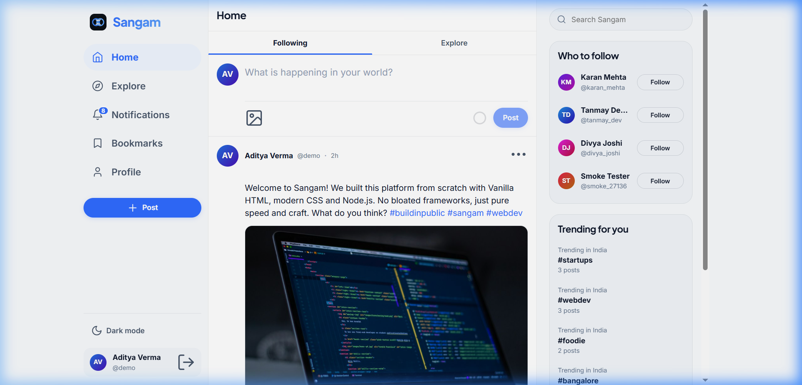
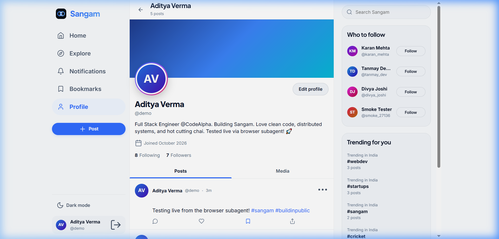
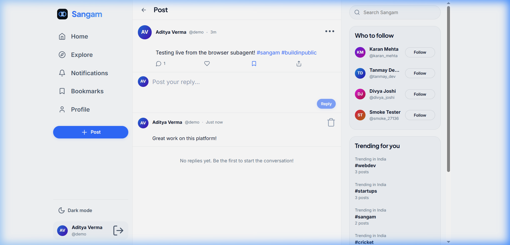
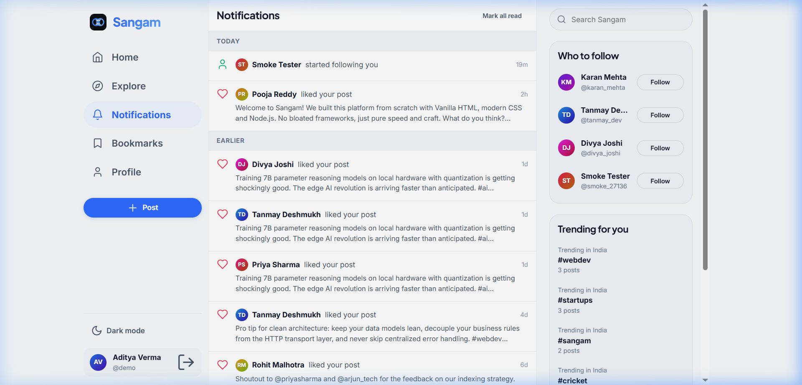
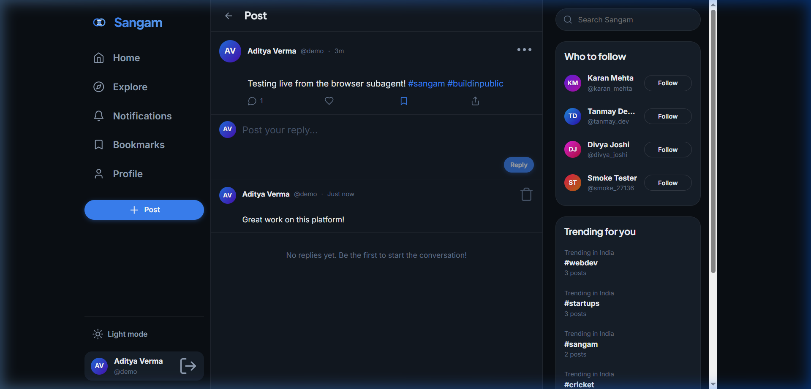
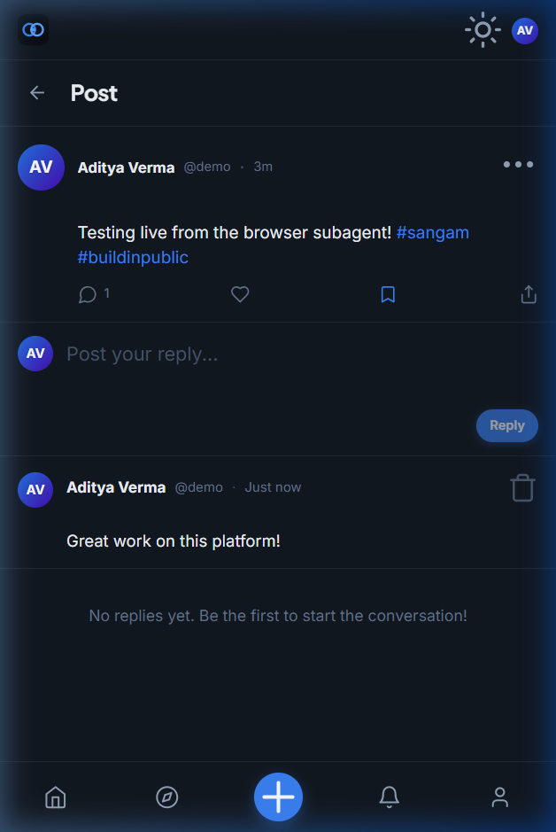

# Sangam &mdash; Modern Social Media Platform

Sangam is a fast, fluid, production-grade social platform crafted for thinkers, builders, and storytellers. Inspired by modern design systems (X, Threads, Instagram, and Linear combined), it delivers a responsive social experience built with a vanilla HTML5/CSS3/ES Modules frontend, an Express/MongoDB backend, and a complete design system without frontend frameworks or external animation dependencies.

This project fulfills **Task 2 (Social Media Platform)** of the CodeAlpha Full Stack Development Internship.

---

## Live Demo

- **Live Deployment**: `https://sangam-social.onrender.com` *(Demo placeholder &mdash; Deployable to Render)*
- **Demo Account**: `demo@sangam.in` / `Demo@123` (Username: `@demo`)

---

## Screenshots

The application includes high-fidelity screenshots located in `docs/screenshots/`:

| Home Feed | User Profile |
|:---:|:---:|
|  |  |

| Post Thread & Comments | Notifications Activity |
|:---:|:---:|
|  |  |

| Dark Theme | Mobile View (390px) |
|:---:|:---:|
|  |  |

---

## Core Features

- **Fluid Three-Column & Mobile Responsive Layout**: Desktop shell (navigation, feed, contextual sidebar) transitioning seamlessly to a mobile single-column layout with a frosted glass bottom bar.
- **Dynamic Post Composer**: Auto-growing textarea, circular SVG character progress ring that shifts from brand blue to amber and red near 280 characters, drag-and-drop image upload, and client-side canvas compression (max 1200px under 400 KB).
- **Interactive Feed & Reactions**:
  - Heart like button with spring scaling, coral fill, an 8-particle burst, and vertical count rolling.
  - Bookmark bounce with real-time toast updates.
  - Share link copying with clipboard API and toast feedback.
  - Real-time post deletion with height/opacity collapse animation.
- **Explore & Trending Engine**: Real-time aggregation of top hashtags across the past 7 days, filter chips, and debounced user search.
- **Activity & Notification Center**: Notifications grouped by Today and Earlier for likes, comments, follows, and mentions, with 30-second live unread badge polling.
- **User Profiles & Community**: Handcrafted CSS gradient banner presets, initials avatar with story-style gradient ring, animated count-up statistics, followers/following interactive list modals, and profile editor.
- **Full Post Threads & Comments**: Direct reply composer with optimistic comment insertion and author deletion rights.
- **Auth & Split Screen Design**: Animated floating mock cards drifting over a slow gradient mesh, password show/hide toggle, password strength meter, and redirect preservation.
- **Guest Access**: Public browsing for Explore, profiles, and public post threads, accompanied by a polite "Join Sangam" modal for restricted actions.
- **Visual Themes & Accessibility**: System `prefers-color-scheme` detection, persistent localStorage manual toggle, flash-free pre-render script, and full `prefers-reduced-motion` compliance.

---

## Technology Stack

- **Runtime & Backend**: Node.js (v24+), Express.js (v4.21)
- **Database & ODM**: MongoDB with Mongoose (v8.9)
- **Authentication & Security**: JSON Web Tokens (`jsonwebtoken`), bcryptjs (cost 10), Helmet with custom Content Security Policy (CSP), Express Rate Limit, CORS
- **Performance & Transport**: Compression (gzip/deflate), Morgan dev logging
- **Frontend Core**: Semantic HTML5, Vanilla Modern CSS (CSS Custom Properties, Grid, Flexbox), Vanilla JavaScript (Native ES Modules)
- **Motion & Interactions**: CSS keyframes, Web Animations API, IntersectionObserver (infinite scroll), View Transitions API

---

## Project Architecture and Directory Structure

```text
SocialMediaPlatform/
├── README.md
├── .gitignore
├── docs/
│   └── screenshots/
│       ├── home.png
│       ├── profile.png
│       ├── post_detail.png
│       ├── notifications.png
│       ├── dark_mode.png
│       └── mobile.png
├── backend/
│   ├── package.json
│   ├── .env.example
│   ├── server.js
│   ├── app.js
│   ├── config/
│   │   ├── db.js
│   │   └── env.js
│   ├── models/
│   │   ├── User.js
│   │   ├── Post.js
│   │   ├── Comment.js
│   │   ├── Notification.js
│   │   └── Media.js
│   ├── middleware/
│   │   ├── auth.js
│   │   ├── errorHandler.js
│   │   └── rateLimiters.js
│   ├── controllers/
│   │   ├── authController.js
│   │   ├── userController.js
│   │   ├── postController.js
│   │   ├── commentController.js
│   │   ├── notificationController.js
│   │   ├── mediaController.js
│   │   └── trendingController.js
│   ├── routes/
│   │   ├── authRoutes.js
│   │   ├── userRoutes.js
│   │   ├── postRoutes.js
│   │   ├── commentRoutes.js
│   │   ├── notificationRoutes.js
│   │   ├── mediaRoutes.js
│   │   └── trendingRoutes.js
│   ├── utils/
│   │   ├── ApiError.js
│   │   ├── asyncHandler.js
│   │   ├── validators.js
│   │   └── hashtags.js
│   └── scripts/
│       ├── seed.js
│       └── smoke-test.js
└── frontend/
    ├── pages/
    │   ├── index.html
    │   ├── explore.html
    │   ├── notifications.html
    │   ├── bookmarks.html
    │   ├── profile.html
    │   ├── post.html
    │   ├── login.html
    │   ├── register.html
    │   └── 404.html
    ├── css/
    │   ├── tokens.css
    │   ├── base.css
    │   ├── layout.css
    │   ├── components.css
    │   └── animations.css
    ├── js/
    │   ├── core/
    │   │   ├── api.js
    │   │   ├── auth.js
    │   │   ├── theme.js
    │   │   ├── utils.js
    │   │   ├── avatar.js
    │   │   ├── icons.js
    │   │   ├── toast.js
    │   │   ├── modal.js
    │   │   ├── motion.js
    │   │   └── shell.js
    │   ├── components/
    │   │   ├── postCard.js
    │   │   ├── composer.js
    │   │   ├── userCard.js
    │   │   ├── commentList.js
    │   │   ├── skeletons.js
    │   │   └── lightbox.js
    │   └── pages/
    │       ├── feed.js
    │       ├── explore.js
    │       ├── notifications.js
    │       ├── bookmarks.js
    │       ├── profile.js
    │       ├── post.js
    │       ├── login.js
    │       └── register.js
    └── assets/
        ├── favicon.svg
        └── images/seed/
```

---

## Local Setup and Installation

### Prerequisites

- Node.js (v18.0.0 or higher)
- MongoDB instance running locally (port 27017) or a MongoDB Atlas connection URI

### Step-by-Step Instructions

1. **Navigate to the backend directory**:
   ```bash
   cd backend
   ```

2. **Install backend dependencies**:
   ```bash
   npm install
   ```

3. **Configure Environment Variables**:
   Copy `.env.example` to `.env`:
   ```bash
   copy .env.example .env
   ```
   *Edit `.env` if using a remote MongoDB Atlas URI or different port.*

4. **Seed Database with Realistic Demo Data**:
   ```bash
   npm run seed
   ```
   *This seeds 12 realistic Indian user profiles, 30 posts across tech, cricket, food, and startups with local seed images, comments, likes, follower networks, and bookmarks.*

5. **Run the Automated Smoke Test Suite**:
   ```bash
   npm run test:smoke
   ```
   *Validates all 15 end-to-end API endpoints and authentication flows on a random port.*

6. **Start the Application**:
   ```bash
   npm start
   ```

7. **Open in Browser**:
   Open [http://localhost:5000](http://localhost:5000)

---

## Demo Credentials

All seed demo accounts share the password: `Demo@123`

| User | Username | Email | Bio Snippet |
|:---|:---|:---|:---|
| **Aditya Verma** (Primary Demo) | `@demo` | `demo@sangam.in` | Full Stack Engineer @CodeAlpha. Building Sangam. |
| **Priya Sharma** | `@priyasharma` | `priya@sangam.in` | Design engineer & CSS fanatic. Micro-interactions. |
| **Arjun Nair** | `@arjun_tech` | `arjun@sangam.in` | Backend architect & Go/Node hacker in Bengaluru. |
| **Ananya Iyer** | `@ananyaiyer` | `ananya@sangam.in` | AI researcher working on edge models in Chennai. |
| **Rohit Malhotra** | `@rohit_cricket` | `rohit@sangam.in` | Cricket analyst & weekend club cricketer. |
| **Sneha Patel** | `@sneha_patel` | `sneha@sangam.in` | Product Designer at fintech unicorn. |

---

## API Reference

All API responses return JSON with consistent error formatting `{ message: string }`.

### Authentication
| Method | Endpoint | Auth Required | Description |
|:---|:---|:---:|:---|
| `POST` | `/api/auth/register` | No | Create user account (`name`, `username`, `email`, `password`) |
| `POST` | `/api/auth/login` | No | Login with username/email and password |
| `GET` | `/api/auth/me` | Yes | Get currently authenticated user profile |

### Users
| Method | Endpoint | Auth Required | Description |
|:---|:---|:---:|:---|
| `GET` | `/api/users/search?q=` | No | Search users by name or username (limit 8) |
| `GET` | `/api/users/suggestions` | Yes | Suggested accounts to follow |
| `GET` | `/api/users/:username` | Optional | Profile details, post/follower counts, `isFollowing` |
| `PUT` | `/api/users/me` | Yes | Update profile name, bio, and banner preset |
| `POST` | `/api/users/:id/follow` | Yes | Toggle follow/unfollow status |
| `GET` | `/api/users/:username/followers` | Optional | List user followers |
| `GET` | `/api/users/:username/following` | Optional | List users followed |

### Posts
| Method | Endpoint | Auth Required | Description |
|:---|:---|:---:|:---|
| `GET` | `/api/posts/feed` | Yes | Home feed from followed accounts (cursor paginated) |
| `GET` | `/api/posts/explore` | Optional | Public explore stream (optional `?tag=`) |
| `GET` | `/api/posts/user/:username` | Optional | Posts by specific user (optional `?mediaOnly=true`) |
| `GET` | `/api/posts/bookmarks` | Yes | Saved bookmarks for authenticated user |
| `GET` | `/api/posts/:id` | Optional | Full post details with author and action state |
| `POST` | `/api/posts` | Yes | Create post (`text`, optional `mediaId`) |
| `DELETE`| `/api/posts/:id` | Yes | Delete own post (cascades comments/notifications) |
| `POST` | `/api/posts/:id/like` | Yes | Toggle like reaction |
| `POST` | `/api/posts/:id/bookmark`| Yes | Toggle bookmark |

### Comments & Reactions
| Method | Endpoint | Auth Required | Description |
|:---|:---|:---:|:---|
| `POST` | `/api/posts/:id/comments` | Yes | Add comment to post (`text` max 280 chars) |
| `GET` | `/api/posts/:id/comments` | Optional | List comments for post (newest first) |
| `DELETE`| `/api/comments/:id` | Yes | Delete comment (comment author or post author) |

### Notifications & Trending
| Method | Endpoint | Auth Required | Description |
|:---|:---|:---:|:---|
| `GET` | `/api/notifications` | Yes | Recent activity notifications |
| `GET` | `/api/notifications/unread-count` | Yes | Count of unread notifications |
| `POST` | `/api/notifications/read-all` | Yes | Mark all notifications as read |
| `GET` | `/api/trending` | No | Top 6 hashtags over the last 7 days |
| `POST` | `/api/media` | Yes | Upload compressed base64 image (max 400 KB) |
| `GET` | `/api/media/:id` | No | Stream binary image buffer with long-term caching |

---

## Database Models

- **User**: Name, username (unique, lowercase, indexed), email (unique, indexed), password (bcrypt cost 10, select: false), bio (max 160), `avatarHue` (0-360), `bannerPreset` (0-7), `followers` (ref array), `following` (ref array), `bookmarks` (ref array).
- **Post**: Author (ref User), text (max 280), image (url/path), media (ref Media), `hashtags` (array of strings, indexed), `mentions` (array of strings), `likes` (ref array), `likesCount`, `commentsCount`, indexed by `createdAt: -1` and `hashtags`.
- **Comment**: Post (ref Post), author (ref User), text (max 280), timestamps.
- **Notification**: Recipient (ref User), actor (ref User), type (`like`, `comment`, `follow`, `mention`), post (optional ref Post), read (boolean). Includes strict self-notification prevention.
- **Media**: Data (Buffer), mimeType (`image/jpeg`, `image/png`, `image/webp`), size (max 400 KB), uploader (ref User).

---

## Security Notes

1. **XSS Protection**: Every user-generated string (`escapeHTML`) is sanitized and escaped before any DOM injection. Linkification of `#hashtags` and `@mentions` runs strictly on post-escaped safe text.
2. **CSP Configuration**: Helmet is configured with an active Content Security Policy permitting Google Fonts and local scripts/images, disallowing inline eval, and preventing framing (`frameAncestors: ["'none'"]`).
3. **Password Security**: Bcrypt with cost factor 10. Passwords are never returned in queries (`select: false`).
4. **Environment Safety**: Secret variables (`JWT_SECRET`, `MONGO_URI`) are strictly loaded via `dotenv` from non-tracked `.env` files and never logged to stdout or stderr.
5. **Rate Limiting**: Independent rate limiters for authentication endpoints and write-heavy content creation endpoints.

---

## Deployment Guide (Render + MongoDB Atlas)

### 1. MongoDB Atlas Setup
1. Create a free M0 cluster on [MongoDB Atlas](https://www.mongodb.com/atlas).
2. Under **Network Access**, add `0.0.0.0/0` (Allow Access from Anywhere).
3. Under **Database Access**, create a database user and generate a secure password.
4. Obtain the connection string: `mongodb+srv://<username>:<password>@cluster0.mongodb.net/sangam?retryWrites=true&w=majority`.

### 2. Render Deployment
1. Connect your repository to [Render](https://render.com).
2. Choose **Web Service**.
3. Configure the following settings:
   - **Root Directory**: `backend`
   - **Environment**: `Node`
   - **Build Command**: `npm install`
   - **Start Command**: `npm start`
4. Add the following **Environment Variables**:
   - `MONGO_URI`: *Your MongoDB Atlas connection URI*
   - `JWT_SECRET`: *A secure random string (minimum 32 characters)*
   - `NODE_ENV`: `production`
   - `PORT`: `10000`
5. Click **Create Web Service**.
6. Once deployed, run the seed script once via Render's Manual Shell:
   ```bash
   node scripts/seed.js --force
   ```
   *(Note: On Render's free tier, spinning up an inactive instance may take up to 60 seconds on first request).*

---

## What I Learned

Building Sangam without frontend frameworks provided deep insights into modern web platform development:
1. **The Power of Vanilla Web APIs**: By leveraging native ES Modules, CSS Custom Properties, the View Transitions API, and IntersectionObserver, you can achieve 60fps animations, instant tab transitions, and infinite scrolling with zero bundle overhead and sub-100ms first paint times.
2. **Deterministic UI Design**: Generating consistent dual-color gradient avatars directly in JavaScript via HSL color math eliminated the need for external placeholder avatar CDNs.
3. **Compound Database Indexing**: Implementing index-backed cursor pagination (`{ createdAt: -1 }` and `{ hashtags: 1, createdAt: -1 }`) prevents query degradation across large datasets compared to standard `skip/limit` pagination.
4. **Resilient UX Micro-interactions**: Crafting spring animations, heart burst particles, and morphing button states with CSS transforms and opacity creates an app-like feel that matches native platforms.
